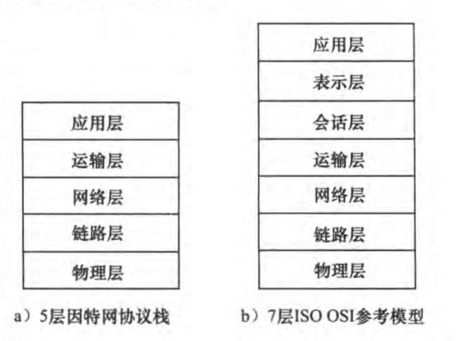
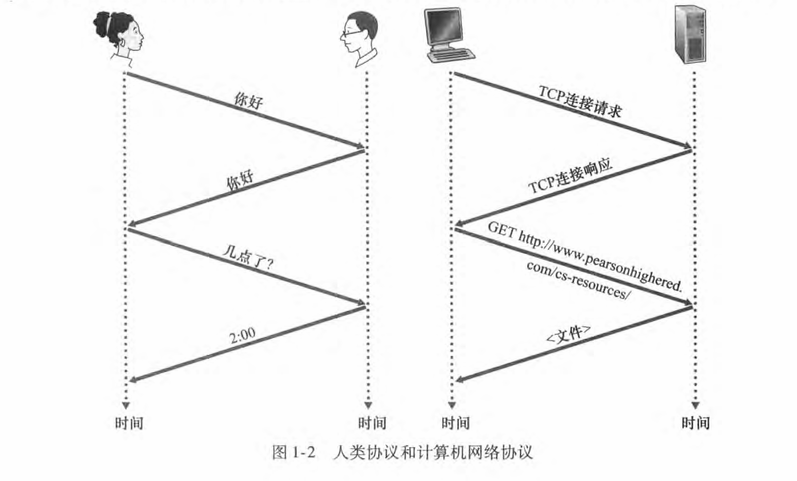
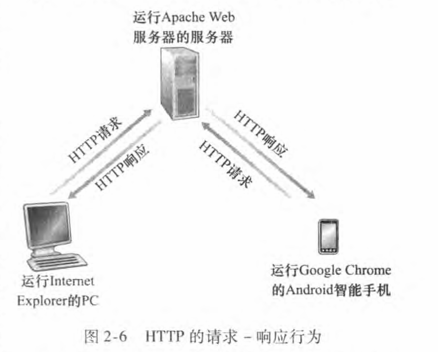
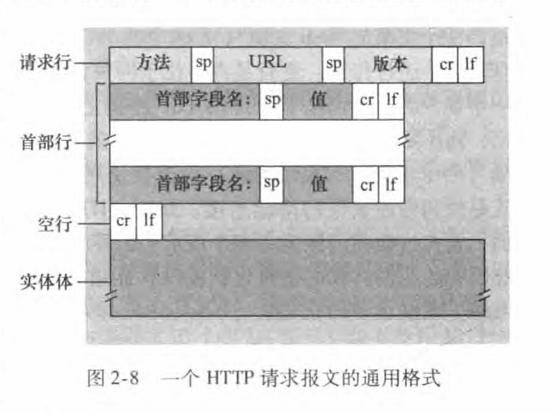
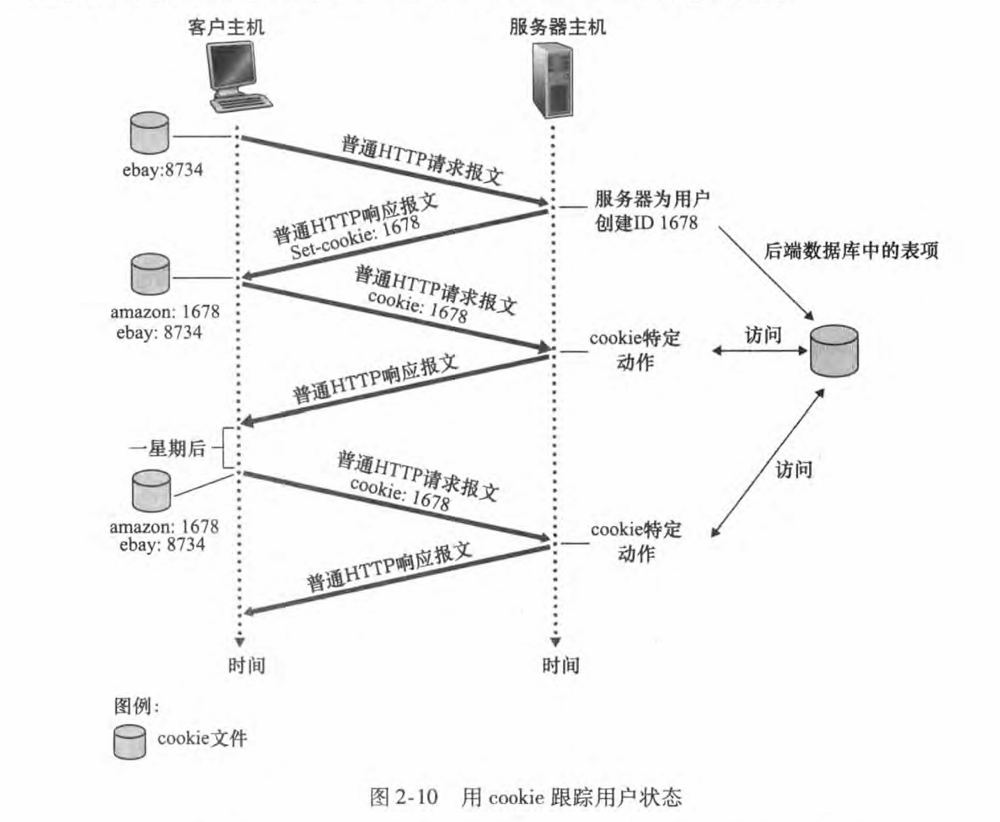

# 网络编程与并发

## 0. 课程概览

### 0.1 一条主线

如果把两台电脑想象成两个人，网络编程要解决的，就是让他们隔着很远的距离，仍然能听懂对方在说什么。

这条主线可以拆成四个问题：

1. 数据怎么从我的电脑走到对方的电脑？——**IP、端口、分层**
2. 数据在路上会不会丢？要不要保证顺序？——**TCP / UDP**
3. 我的程序怎么调用操作系统来收发数据？——**Socket**
4. 数据到了以后，双方按什么格式交流？——**HTTP**

最后，我们再回答一个问题：一个服务器要同时接待很多客户端，怎么办？——**进程、线程、协程、asyncio**。

### 0.2 时间表

| 时间          | 模块     | 主要内容                               |
| ----------- | ------ | ---------------------------------- |
| 0–20 min    | 网络基础   | 什么是因特网、边缘/核心、时延、协议与分层、IP 与端口       |
| 20–60 min   | 运输层    | 端口复用、TCP 三次握手/四次挥手、可靠传输、UDP、字节流    |
| 70–95 min   | Socket | API 生命周期、TCP echo、UDP echo、常见坑     |
| 95–125 min  | HTTP   | 报文结构、方法/状态码、头/体、Cookie、HTTPS、客户端代码 |
| 135–175 min | 并发     | 进程/线程/协程、GIL、asyncio 概览            |

---

## 1. 网络基础

### 1.1 什么是因特网

描述因特网有两种互补的方式：一种看它由哪些部件构成，另一种看它能提供什么服务。

从构成上看，因特网是一个世界范围的计算机网络：数以亿计的计算设备——台式机、笔记本、手机、服务器、手表、汽车——通过通信链路和分组交换机连接在一起。接入网络的这些设备称为**端系统（end system）**，因为真正产生和消费数据的应用都运行在网络的"边缘"。**链路（link）**是连接端系统的物理介质，包括双绞铜线、光纤和无线电。**分组交换机（packet switch）**把到达一个链路的分组转发到另一个链路，最常见的两种是路由器和链路层交换机。端系统通过 **ISP（Internet Service Provider，因特网服务提供商）**接入因特网，ISP 之间再互相连接，形成层次结构。

从服务上看，因特网是"为分布式应用提供通信服务的基础设施"。Web、电子邮件、视频流、即时通信，都是运行在端系统上的分布式应用。因特网本身不关心应用传输的是网页还是邮件，它只负责把数据从一个端系统搬到另一个端系统。

> **生活类比：寄快递**
> 你写的信是数据，装进信封是分组，快递站是分组交换机，公路和航线是链路，快递公司是 ISP。网络不关心信封里是情书还是账单，只负责把包裹送到。

这里有一个贯穿全课的判断：**网络核心只搬运数据，赋予数据意义的是两端应用。** 后面讲 HTTP 时，我们看的都是端系统上的程序如何约定格式，而不是路由器怎么转发。

### 1.2 网络边缘与网络核心

按位置把因特网分成两部分。**网络边缘**由端系统和接入网组成，是你手里的电脑、手机，以及 Wi-Fi、4G/5G、光纤入户这些把端系统接入核心的链路。**网络核心**由分组交换机和链路组成，负责在端系统之间搬运数据。


核心部分有两种典型工作方式。**分组交换（packet switching）**把数据切成一个个分组，每个分组独立选择路径，谁有空谁先走；它像快递拼车，灵活、便宜，但可能排队。**电路交换（circuit switching）**在通信前先占用一条专用线路，通话期间别人不能用；它像包一辆专车，稳定，但资源浪费。因特网采用分组交换，代价是可能排队和丢包，收益是资源共享、成本低。

### 1.3 分组交换中的时延、丢包与吞吐量

数据在路上会经历四种时延。**处理时延**是路由器检查分组首部、决定转发方向的时间；**排队时延**是分组在输出队列里等待发送的时间；**传输时延**是把分组的全部比特推上链路的时间；**传播时延**是信号在介质中传播的时间。前两者取决于路由器的负载，后两者分别取决于链路带宽和物理距离。

以传输时延为例：一个长度为 L 比特的分组，经过速率为 R 比特/秒的链路，传输时延为 L/R。把 1000 比特推到 100 Mbps 的链路上只需 10 微秒；换成 1 Mbps，就需要 1 毫秒。这就是"同样的数据，链路越慢，装车越久"。

如果输出队列已满，新到的分组会被丢弃，这叫**丢包（packet loss）**。**吞吐量（throughput）**则是单位时间内成功穿过网络的数据量，通常受路径上最慢那一段链路限制。

### 1.4 协议与分层

**协议（protocol）**是通信双方共同遵守的规则，至少包括三件事：**语法**，即数据长什么样；**语义**，即每个字段是什么意思、收到后做什么；**时序**，即谁先发、谁后发、何时回应。


坐飞机要买票、托运行李、登机、起飞、降落、取行李，每一步都有约定，少一步都不行。协议也一样：它不是某段代码，而是一连串约定好的动作。两个人见面说"你好"，和客户端与服务器建立 TCP 连接，本质上是同一件事：先确认对方能听见，再开始说正事。

因特网协议按层组织，教学中最常用的是五层模型：

| 层次  | 职责          | 典型协议      |
| --- | ----------- | --------- |
| 应用层 | 为应用程序提供网络服务 | HTTP、DNS  |
| 运输层 | 把数据送到正确的进程  | TCP、UDP   |
| 网络层 | 把分组送到正确的主机  | IP        |
| 链路层 | 在相邻节点之间传帧   | 以太网、Wi-Fi |
| 物理层 | 在介质上传输比特    | 光纤、双绞线    |



数据从应用层往下走，每层加一个首部，这叫**封装**；接收方从下往上拆，叫**解封装**。运输层关心"从源进程到目的进程"，是**端到端**；网络层及以下关心"从这一跳到下一跳"，是**逐跳**。TCP 的确认和重传是端到端的，IP 本身并不保证可靠。

### 1.5 IP 地址与端口

到这里，数据已经能到达目的主机。但一台主机上同时跑着浏览器、微信和 Python 脚本，数据该交给谁？答案分两层：先用 IP 地址找到机器，再用端口找到机器上的程序。

**IP 地址：机器的门牌号。** IPv4 地址是一个 32 位整数，习惯写成点分十进制：四段数字用点隔开，每段 0–255，例如 `192.168.1.10`。一个 IPv4 地址可以粗略分成两部分：前面的**网络号**标识你处在哪个网络，后面的**主机号**标识网络里的哪台机器。就像"重庆市南岸区"是网络号，"某某宿舍 302"是主机号，先找到区域，再找到具体房间。（IPv6 是 128 位，写成冒号分隔的十六进制，如 `2001:db8::1`；课堂先用 IPv4，概念是相通的。）

实际使用中，有三类地址要先分清：

| 类型   | 例子                                       | 含义                       |
| ---- | ---------------------------------------- | ------------------------ |
| 私有地址 | `192.168.x.x`、`10.x.x.x`、`172.16–31.x.x` | 局域网内部使用，不能直接在公网路由        |
| 回环地址 | `127.0.0.1`                              | 永远指向本机，只有自己能访问           |
| 通配地址 | `0.0.0.0`                                | 绑定/监听所有网卡，局域网里的其他机器也能连进来 |

私有地址是家里、学校、公司内网最常见的一类地址；`127.0.0.1` 相当于"自己家的后门"，无论电脑有没有联网，访问它都是访问自己；`0.0.0.0` 相当于"小区所有大门都开着"，服务端绑定它，别人才能从外面连进来。

**端口号：门牌号上的房间号。** 端口号是一个 16 位整数，范围 `0–65535`。它按用途分成三段：

| 范围 | 名称 | 说明 |
|---|---|---|
| 0–1023 | 熟知端口 | 固定分配给常见服务，如 80 HTTP、443 HTTPS、22 SSH、53 DNS；监听这些端口通常需要管理员权限 |
| 1024–49151 | 注册端口 | 分配给一般应用，如 3306 MySQL、6379 Redis |
| 49152–65535 | 动态/临时端口 | 客户端发起连接时由操作系统临时分配，用完就回收 |

服务端通常监听一个固定端口，客户端则使用操作系统分配的临时端口。所以同一台机器可以同时跑 Web、MySQL、Redis：它们的 IP 相同，但端口不同，数据不会送错门。

**IP + 端口 = socket。** 把 IP 和端口放在一起，就唯一确定了网络中的一个通信端点，也就是 socket。一条 TCP 连接由四元组唯一确定：`源 IP、源端口、目的 IP、目的端口`。只写 IP 不够，因为一台机器上可能开着很多服务；只写端口也不够，因为同一端口在不同机器上是不同的东西。

域名系统 DNS 只做一件事：把域名翻译成 IP 地址。你输入 `www.example.com`，浏览器先问 DNS 这个域名对应哪个 IP，再根据协议默认端口（HTTP 80、HTTPS 443）或 URL 里写的端口，才能建立连接。DNS 不负责端口，也不负责建立连接，它只是"电话簿"。

> **生活类比：寄快递到宿舍**
> IP 地址是"哪栋楼"，端口号是"哪个房间"；socket 就是"楼号 + 房间号"这个完整地址。`127.0.0.1` 是"寄给自己"，`0.0.0.0` 是"所有楼栋的门卫都代收"。DNS 则是你手机里的通讯录：把"张三"翻译成具体的楼号和房间号。

一句话收束：**IP 找机器，端口找程序。**

### 1.6 本章小结

这一节做了三件事：把因特网拆成边缘和核心，知道数据由分组交换机一段一段搬运；知道网络会慢、会丢包，原因可以落到四种时延和排队；知道协议是分层约定，IP 找机器、端口找程序。

### 1.7 故事线串讲：一个请求包的旅程

现在把书合上。我们跟着一个请求包，从你的键盘出发，把这一章重新走一遍。

晚上十点，你在宿舍打开选课网站，按下回车。浏览器把请求交给操作系统，操作系统把它切成一个个分组——为什么不一口气发完？因为链路上不止你一个人。切成小块，大家轮流走，网络才能被很多人共享。

分组离开网卡，进入宿舍的 Wi-Fi。Wi-Fi 是一种**链路**，也就是把端系统连出去的物理通道；除了无线电，链路还可以是双绞线、光纤。你的电脑、手机、服务器，在网络里统称**端系统**，它们是数据的起点和终点，网站、微信、游戏都跑在它们身上。

Wi-Fi 之后，分组到达宿舍楼的路由器，再进入学校网络，最后交给运营商。运营商就是 **ISP**，因特网服务提供商。在岔路口负责选路和转发的设备叫**分组交换机**，最常见的是路由器和交换机。每个分组到一台交换机，就像包裹到一个快递中转站：看一眼地址，把它放进对应的下一班车。

到这里，你还在**网络边缘**——端系统、Wi-Fi、接入网都在这一侧。再往前，路由器和高速链路组成的**网络核心**，只负责运输，不关心箱子里装的是网页还是邮件。

核心有两种走法。**电路交换**先占一条专线，通话期间别人不能用，像包一辆专车，稳，但空着也浪费；**分组交换**把数据切成组，每组独立选路，谁有空谁先走，像快递拼车，便宜灵活，但高峰期要排队。因特网选了拼车，所以它用共享换来了低成本，也换来了排队和丢包。

包为什么会迟到？路由器收到分组，先检查首部、决定往哪转发，这是**处理时延**；决定好了，可能还要在输出队列里排队，这是**排队时延**；轮到它，把全部比特推上链路，这是**传输时延**；信号沿着光纤跑完那段距离，这是**传播时延**。前两个看路由器忙不忙，后两个看链路快不快、距离远不远。要是队列满了，新来的包会被直接丢掉，这就是**丢包**；单位时间真正送达的数据量，叫**吞吐量**，通常被路径上最慢的那一段卡住。

终于到了服务器。可一台主机上跑着 Web 服务、数据库、缓存，包该交给谁？靠端口。**IP 地址找机器，端口找程序**：Web 通常监听 80，HTTPS 监听 443。你输入的域名会先由 DNS 翻译成 IP，浏览器拿到 IP 和端口，才真正开始连接。这里有两个地址别搞混：`127.0.0.1` 是本机回环，只有自己能访问；`0.0.0.0` 是监听所有网卡，别人也能连进来。

最后，我们看包是怎么被一层层拆开的。因为双方都守**协议**：数据长什么样，是**语法**；每个字段什么意思、收到后做什么，是**语义**；谁先发、谁后发、何时回应，是**时序**。网络分成五层：应用层、运输层、网络层、链路层、物理层。发的时候往下走，一层套一个首部，叫**封装**；收的时候往上拆，叫**解封装**。运输层管"从哪个程序到哪个程序"，是**端到端**；网络层及以下管"从这一跳到下一跳"，是**逐跳**。

服务器处理完请求，回一个响应，沿着原路返回。两秒后，页面出现在你的屏幕上。

这一趟走完，这一章也就走完了。下一章，我们把镜头拉近到运输层，看这批货到底要不要保丢、保序。

---

## 2. 运输层：TCP 与 UDP

运输层要解决两个问题：**送到哪个程序？**——靠端口；**要不要保证可靠？**——TCP 选择保证，UDP 选择不保证。

### 2.1 端口与复用

一台主机上同时跑着浏览器、微信、游戏、Python 脚本。数据到了主机，操作系统怎么知道该交给哪个程序？靠的就是**端口号**。

服务器通常监听一个固定端口，比如 HTTP 服务器监听 80；客户端连接时，操作系统会临时分配一个端口，叫**临时端口（ephemeral port）**。一个连接由四元组唯一确定：`源 IP、源端口、目的 IP、目的端口`。门牌号只有一个，不能同时住两户人家——所以同一个端口也不能被两个程序同时监听。

几个常见端口值得记一下：

| 端口 | 服务 |
|---|---|
| 80 | HTTP |
| 443 | HTTPS |
| 53 | DNS |
| 3306 | MySQL |
| 6379 | Redis |

### 2.2 TCP 三次握手

TCP 是**面向连接**的。发数据之前，双方要先建立连接，这个过程就是**三次握手（three-way handshake）**。



```text
客户端                          服务器
  | ------ SYN (seq=x) ---------> |
  | <---- SYN-ACK (seq=y, ack=x+1)|
  | ------ ACK (ack=y+1) --------> |
  |           连接建立             |
```

第一次，客户端发送 `SYN`，意思是"我想和你建立连接，我的初始序号是 x"。第二次，服务器回复 `SYN-ACK`，意思是"我收到了，我的初始序号是 y，我期待你下一个序号是 x+1"。第三次，客户端发送 `ACK`，意思是"我收到了你的序号 y，我期待你下一个序号是 y+1"。

为什么不是两次？两次只能确认"客户端能发、服务器能收"，以及"服务器能发、客户端能收"中的一部分。第三次 `ACK` 让服务器确认"客户端确实收到了我的 `SYN-ACK`"。同时，三次握手还交换了初始序号，为后面的可靠传输打基础。

### 2.3 四次挥手与 TIME_WAIT

连接用完之后要关闭。TCP 是全双工的，两个方向要分别关闭，所以通常是四次挥手：

```text
客户端                          服务器
  | ------ FIN -----------------> |
  | <----- ACK ------------------ |
  | <----- FIN ------------------ |
  | ------ ACK -----------------> |
```

客户端说"我没数据要发了"（FIN）；服务器先确认（ACK），但可能还有数据要发，所以不能立刻关；服务器发完数据后，也发一个 FIN；客户端确认（ACK）。

主动关闭的一方会进入 **TIME_WAIT** 状态，等待 2MSL（最大报文段生存时间的两倍）。原因有两个：确保最后一个 ACK 能到达对方；让旧连接中的迟到报文在网络中消失，避免影响新连接。

### 2.4 可靠传输：序号、确认、重传（8 min）

| 机制 | 作用 |
|---|---|
| 序号（sequence number） | 给每个字节编号，接收方知道收到哪了 |
| 确认（ACK） | 接收方告诉发送方"我收到了" |
| 超时重传 | 一段时间没收到确认，就重发 |
| 快速重传 | 收到多个重复 ACK，提前重发 |
| 去重与重排 | 重复的丢掉，乱序的按序号排好 |
| 滑动窗口 | 一次允许多少数据在路上，提高效率 |

这里有两个容易混淆的概念。**流量控制（flow control）**是怕接收方处理不过来，发送方根据接收方的接收窗口调整发送速度；**拥塞控制（congestion control）**是怕网络中间堵住，发送方根据网络状况调整发送速度。这节课只需要知道它们"都在控制速度"，不展开慢启动、拥塞避免等算法。

> **生活类比：快递单号**
> 每个包裹有单号，收件人签收后告诉寄件人"收到了"；寄件人一段时间没收到签收信息，就补发。窗口就像"一次允许多少个包裹在路上"。


### 2.6 UDP：像发电报

UDP 是**无连接**的：不需要握手，直接发。它也不保证可靠：可能丢、可能乱序、可能重复。但它有一个 TCP 没有的好处：**保留报文边界**。你发一个数据报，对方就收一个数据报。

| 对比项  | TCP          | UDP            |
| ---- | ------------ | -------------- |
| 连接   | 面向连接，先握手     | 无连接，直接发        |
| 可靠性  | 可靠，丢包会重传     | 不可靠，丢了就丢了      |
| 顺序   | 保证按序到达       | 不保证            |
| 边界   | 字节流，无消息边界    | 保留报文边界         |
| 速度   | 首部大、机制多，通常更慢 | 首部小、无重传，通常更轻量  |
| 典型场景 | 网页、文件传输、邮件   | DNS、视频、游戏、QUIC |

UDP 不是"差的 TCP"，它是另一种取舍。视频会议宁愿丢一帧，也不愿意等重传；DNS 一次请求一次响应，用 UDP 更轻量。

### 2.7 常见误区

- **TCP 有消息边界。** 没有。TCP 是字节流，边界要应用层自己定。
- **UDP 一定比 TCP 快。** 不一定。UDP 少了握手和重传，但丢包后应用层可能更麻烦。
- **三次握手就是安全。** 不是。握手不加密，安全靠 TLS。
- **TCP 可靠，所以数据一定到。** TCP 会尽力重传，但如果对方彻底断网，连接最终还是会失败。

### 2.8 故事线串讲：一通电话与一张明信片

现在换一个场景，把运输层再走一遍。你要把一份 200 人的名单发给远方的朋友，名单不能少人、不能乱序，于是你选择打电话——这就是 TCP。

拨号不是一拨就通。你先问"能听到吗"（SYN），并报出自己的起始编号 x；对方回"能，你能听到我吗"（SYN-ACK），报出他的编号 y，同时说"我下一条想听 x+1"；你说"能，我下一条想听 y+1"（ACK）。三句话之后，双方都确认了自己能发、对方能收，也交换了起始编号，才正式开始。为什么不能少一句？如果只说两句，对方没法确认你收到了他的回复，也就不敢确定你的接收能力。

通话中，你每说一句都编号（序号），对方回一句"收到，下一条该是几"（ACK）。你一段时间没等到确认，就重说（超时重传）；连续听到几个重复的确认，说明中间漏了一句，你就提前重说（快速重传）。收到重复的句子就丢掉，收到乱序的就按编号排好（去重与重排）。对方还会提醒你"我这边忙，慢点说"（流量控制）；网络中间堵了，你也要自己放慢（拥塞控制）。这些机制合起来，才叫"可靠"。

当然，可靠不等于一定送到。如果对方彻底关机、断网，你喊多久都没人应，连接最终会超时失败；TCP 只能保证"在连接还活着的时候，尽量不丢、不乱"，不能保证对方永远在线。这也是后面写服务器时，必须处理超时和断线的原因。

还有一点：打电话占线是有成本的。你占着一条连接，别人就打不进来；服务器要同时接很多人，就得为每条连接准备资源，这正是后面并发要解决的问题。

再看窗口：对方说"我一次最多能接五句"，你就最多连着说五句，等确认再继续；这就是滑动窗口，既不会把对方淹没，也不会一次只发一句那么慢。

但注意，电话传过去的是连续的声音，不是一封封写好的信。你说"第一句、第二句"，对方听到的是一条连续的声流，可能把两句话连在一起。这就是 TCP 的字节流：没有消息边界。所以你们要事先约定：要么每段话先报"这段话有 20 个字"（长度前缀），要么每段话都以"完"字收尾（分隔符）。否则对方根本不知道一句到哪儿结束。

说完了要挂电话。你说"我没话了"（FIN），对方说"好"（ACK），但他可能还有话，等他说完再发一个 FIN，你再 ACK。主动挂的一方还要等一会儿（TIME_WAIT），确保最后一句"好"送达，也让旧电话的余音散掉，免得串到下一通电话里。

如果这份名单不急、丢一两个也无所谓，你可以改寄一张明信片，也就是 UDP。不用拨号，写好直接投；一张明信片就是一个完整消息，有边界；可能丢、可能晚到，但发起来简单。视频会议宁愿丢一帧也不愿等重传，DNS 一次问一次答，用明信片就够。TCP 像打电话：先接通、保顺序、丢了补；UDP 像寄明信片：不保证送达，但每条都完整，而且便宜。所以选 TCP 还是 UDP，本质上是在问：这份数据，是"必须一字不差送到"，还是"准时送到比完整更重要"。

---

## 3. Socket 编程
### 3.1 Socket 是什么

**Socket（套接字）**是操作系统提供给应用程序的网络编程接口。你可以把它理解成一根"电话线"的插孔：程序往插孔里写数据，操作系统负责把数据送出去。

一个 TCP 连接由四元组唯一确定：`源 IP、源端口、目的 IP、目的端口`。在 Python 里，创建 socket 只需要一行：

```python
from socket import socket, AF_INET, SOCK_STREAM

s = socket(AF_INET, SOCK_STREAM)   # IPv4 + TCP
```

- `AF_INET`：使用 IPv4 地址。
- `SOCK_STREAM`：使用 TCP。
- `SOCK_DGRAM`：使用 UDP。

TCP 服务端和客户端的生命周期可以对照着看：

| 步骤 | 服务端 | 客户端 |
|---|---|---|
| 1 | `socket()` 创建套接字 | `socket()` 创建套接字 |
| 2 | `bind()` 绑定 IP 和端口 | |
| 3 | `listen()` 开始监听 | |
| 4 | `accept()` 等待连接 | `connect()` 发起连接 |
| 5 | `recv()` / `sendall()` | `sendall()` / `recv()` |
| 6 | `close()` | `close()` |

这里有个容易忽略的细节：服务端的监听 socket 像公司总机，一直开着；`accept()` 接到一个电话后，会返回一个新的连接 socket，相当于转给一个分机。总机继续等下一个电话，所以**`accept()` 返回的是一个新的 socket，和监听 socket 不是同一个**。

### 3.2 TCP echo：最小可运行例子

我们写一个最简单的 echo 服务：客户端发一句话，服务端把字母转成大写再发回来。这个例子和教材里的 `TCPClient.py` / `TCPServer.py` 是同一个思路，只是把地址改成 `127.0.0.1`，并用了更安全的 `sendall`。

**tcp_server.py**

```python
from socket import AF_INET, SOCK_STREAM, SOL_SOCKET, SO_REUSEADDR, socket

HOST = "127.0.0.1"
PORT = 9000

with socket(AF_INET, SOCK_STREAM) as server:
    server.setsockopt(SOL_SOCKET, SO_REUSEADDR, 1)
    server.bind((HOST, PORT))
    server.listen(1)
    print(f"TCP server listening on {HOST}:{PORT}")

    conn, addr = server.accept()
    with conn:
        print("Connected by", addr)
        data = conn.recv(1024)
        print("Received:", data.decode("utf-8"))
        conn.sendall(data.upper())
```

**tcp_client.py**

```python
from socket import AF_INET, SOCK_STREAM, socket

HOST = "127.0.0.1"
PORT = 9000

with socket(AF_INET, SOCK_STREAM) as client:
    client.connect((HOST, PORT))
    message = "hello tcp"
    client.sendall(message.encode("utf-8"))
    reply = client.recv(1024)
    print("From server:", reply.decode("utf-8"))
```

打开两个终端，先运行 `python tcp_server.py`，再运行 `python tcp_client.py`，大致会看到：

```text
# 服务端
TCP server listening on 127.0.0.1:9000
Connected by ('127.0.0.1', 54321)
Received: hello tcp

# 客户端
From server: HELLO TCP
```

逐行看几个关键点：

- `setsockopt(SOL_SOCKET, SO_REUSEADDR, 1)`：允许端口快速重用，避免重启服务时遇到"Address already in use"。
- `bind((HOST, PORT))`：把 socket 绑定到地址和端口。服务端必须绑定，客户端通常不用。
- `listen(1)`：开始监听，参数是等待队列的长度。改成 `listen(5)` 只是加长队列，不会让服务端同时处理多个客户端。
- `accept()`：阻塞等待客户端连接；有连接后返回一个新的 `conn` 和客户端地址。
- `recv(1024)`：最多读 1024 字节。这里为了简单只读一次；真实协议要循环读或定帧。
- `sendall()`：确保所有字节都发出去。`send()` 可能只发一部分，初学阶段用 `sendall()` 更省心。
- `with conn:`：离开代码块时自动关闭连接，等价于 `conn.close()`。

### 3.3 UDP echo：没有连接也能发

UDP 的代码更短：没有 `listen`、`accept`、`connect`，直接 `sendto` / `recvfrom`。

**udp_server.py**

```python
from socket import AF_INET, SOCK_DGRAM, socket

HOST = "127.0.0.1"
PORT = 9001

with socket(AF_INET, SOCK_DGRAM) as server:
    server.bind((HOST, PORT))
    print(f"UDP server listening on {HOST}:{PORT}")

    data, addr = server.recvfrom(2048)
    print("Received from", addr, ":", data.decode("utf-8"))
    server.sendto(data.upper(), addr)
```

**udp_client.py**

```python
from socket import AF_INET, SOCK_DGRAM, socket

HOST = "127.0.0.1"
PORT = 9001

with socket(AF_INET, SOCK_DGRAM) as client:
    message = "hello udp"
    client.sendto(message.encode("utf-8"), (HOST, PORT))
    reply, addr = client.recvfrom(2048)
    print("From server:", reply.decode("utf-8"))
```

同样两个终端，先服务端后客户端，输出大致是：

```text
# 服务端
UDP server listening on 127.0.0.1:9001
Received from ('127.0.0.1', 54322) : hello udp

# 客户端
From server: HELLO UDP
```

对比一下 TCP 和 UDP 的代码：TCP 服务端要 `listen` + `accept`，UDP 不需要；TCP 客户端要 `connect`，UDP 直接把地址塞进 `sendto`；TCP 用 `recv`，UDP 用 `recvfrom`，因为 UDP 要告诉你"这个数据报是谁发的"；一次 `sendto` 对应一次 `recvfrom`，报文边界天然保留。

### 3.4 常见坑

| 坑 | 说明 | 正确做法 |
|---|---|---|
| `accept` 返回新 socket | 监听 socket 和连接 socket 是两个对象 | 两个都要关闭，用 `with` 最省心 |
| `recv` 返回 `b''` | 对端关闭了连接 | 判断 `if not data: break` |
| `send` 只发一部分 | 大块数据可能只发出去一部分 | 用 `sendall()` |
| `recv(1024)` 只读一次 | 可能只收到半条消息 | 循环读或长度前缀 |
| 编码错误 | 发送 `str` 会报错 | 先 `.encode("utf-8")`，收到后 `.decode("utf-8")` |
| `127.0.0.1` vs `0.0.0.0` | 前者只允许本机，后者监听所有网卡 | 课堂演示用 `127.0.0.1` |
| 端口被占用 | 上次的服务没退干净 | 换端口，或设置 `SO_REUSEADDR` |
| 阻塞 `accept` | 一次只能服务一个客户端 | 并发问题，下一节解决 |

`recv` 返回空字节 `b""` 不是"没有数据"，而是"对方已经关闭连接"。很多同学会把它当成超时，结果程序陷入死循环。

### 3.5 故事线串讲：总机与分机

把 socket 想成公司总机，把这一章再走一遍。

服务器启动时，先装一部总机（`socket()`），把号码登记好（`bind()`），然后坐在那里等电话（`listen()`）。`listen(1)` 的意思是"排队区只能站一个人"，不是"只能接一个电话"。总机本身不接业务，它只负责接线：有人打进来，总机就把电话转给一个分机（`accept()` 返回的新 socket），由分机负责这一通电话。总机继续等下一个。很多同学会忘记：`accept()` 返回的是分机，不是总机本身，两个都要挂断（`close()`），用 `with` 最省心。

客户端这边简单：拿起电话拨号（`connect()`），接通后说话（`sendall()`），听对方回话（`recv()`），说完挂断。`connect()` 能成功，说明三次握手已经完成；之后双方就在这条连接上收发字节。

这里要注意顺序：服务端必须先 `bind`、`listen`，客户端才能 `connect`；顺序反了，客户端会收到"连接被拒绝"，就像电话还没装好你就拨号。课上的两个终端要先开服务端，再开客户端，原因就在这里。

电话里传的不是一封封信，而是连续的声音，也就是字节流。你 `send` 两次，对方可能一次 `recv` 全听到；你 `send` 一大段，对方可能要 `recv` 好几次。所以要么循环读，要么先报长度。`recv` 返回空字节不是"暂时没声音"，而是"对方挂断了"，要停下来，否则程序会空转。

打电话还有几个规矩。`send` 可能只把一部分话送出去，剩下得再 `send`，所以用 `sendall` 更省心；直接对着电话喊中文（`str`）不行，得先编码成字节（`encode`）；号码被别人占了（端口被占用），要么换号，要么设 `SO_REUSEADDR`；监听地址写 `127.0.0.1`，只有本机能打进来，写 `0.0.0.0`，局域网里的同学才能连。

还有一种更省事的通信：寄明信片，也就是 UDP。不用总机、不用拨号，直接把地址写在明信片上投出去（`sendto`），对方收到后按寄件地址回一张（`recvfrom`）。一张明信片就是一条完整消息，边界天然保留。代价是可能丢、可能乱序，要可靠性就得自己在应用层补。

服务端关闭也有讲究。连接 socket 用完要 `close`，监听 socket 也要在程序结束时关闭；如果只关一个，端口可能一直被占着，下次启动就报"Address already in use"。所以示例里用了 `with`，让 Python 自动收尾。

还有，`accept()` 是阻塞的：没有电话打进来，程序就停在那里等。这不是 bug，而是阻塞式 socket 的默认行为；想一边等电话一边干别的，才需要并发。

调试时如果客户端一直卡在 `recv`，先检查服务端有没有真的 `sendall`；如果服务端一直卡在 `accept`，先检查客户端连的 IP 和端口对不对。网络编程里的很多"卡住"，其实只是两边没对上。记住先总机、再拨号，顺序对了，代码才不容易卡住。

真实的 echo 服务也不会只读一次：客户端可能分几次发，服务端要循环 `recv`，直到读到空字节才退出。示例为了课堂演示只读了一次，真正写服务时要补上循环。另外，TCP 是流式的，客户端连续发两条消息，服务端可能一次就收到两条，别假设一次 `recv` 对应一条 `send`。

总机一次只能接一个电话，后面的只能排队。想同时接很多个，就得多开几个接线员（线程/进程），或者让一个接线员在等电话时去干别的（asyncio）——这就是下一章的并发。

---

## 4. HTTP

### 4.1 HTTP 就是客户端和服务端的一问一答

HTTP（HyperText Transfer Protocol，超文本传输协议）是 Web 的基础。它的模式非常简单：客户端发一个请求，服务端回一个响应。



HTTP 是**无状态**的：服务器默认不记得你上一次来过。每个请求都是独立的。这也是为什么需要 Cookie。

一个 HTTP 报文由四部分组成：**起始行**（请求行或状态行）、**首部**（一串 `键: 值`）、**空行**（一个 `\r\n`，表示首部结束）、**正文**（可选，比如表单、JSON、HTML）。



一个最小的请求长这样：

```http
GET /index.html HTTP/1.1
Host: 127.0.0.1:8000
User-Agent: demo
Connection: close

```

一个最小的响应长这样：

```http
HTTP/1.1 200 OK
Content-Type: text/html; charset=utf-8
Content-Length: 13
Connection: close

hello, world!
```

注意几个细节：起始行和每个首部后面都必须有 `\r\n`，首部结束后还要有一个空行 `\r\n`；HTTP/1.1 的请求通常必须带 `Host` 首部，告诉服务器你要访问哪个站点；`Content-Length` 告诉对方正文有多少字节，如果没有正文，可以不写或写 0。

### 4.2 请求方法

| 方法      | 典型用途        | 是否安全 | 是否幂等 |
| ------- | ----------- | ---- | ---- |
| GET     | 获取资源        | 是    | 是    |
| POST    | 创建资源/提交数据   | 否    | 否    |
| PUT     | 整体替换资源      | 否    | 是    |
| PATCH   | 局部修改资源      | 否    | 通常否  |
| DELETE  | 删除资源        | 否    | 是    |
| HEAD    | 只取响应头       | 是    | 是    |
| OPTIONS | 询问服务器支持哪些方法 | 是    | 是    |

"安全"是指不改变服务器状态；"幂等"是指执行一次和执行多次效果相同。初学阶段记住两句话就够了：**GET 用来拿数据，不应该产生副作用；POST 通常用来提交数据，可能会创建新资源。**

不要用 GET 做删除、转账这类操作。浏览器会预取、缓存、记录 GET 请求，一旦产生副作用，后果可能很严重。

### 4.3 状态码

状态码是服务器给客户端的一句"结果摘要"。第一位数字表示类别：

| 类别  | 含义      | 例子                                                                                 |     |
| --- | ------- | ---------------------------------------------------------------------------------- | --- |
| 1xx | 信息，继续处理 | 100 Continue                                                                       |     |
| 2xx | 成功      | 200 OK、201 Created、204 No Content                                                  |     |
| 3xx | 重定向     | 301 Moved Permanently、302 Found、304 Not Modified                                   |     |
| 4xx | 客户端错误   | 400 Bad Request、401 Unauthorized、403 Forbidden、404 Not Found、429 Too Many Requests |     |
| 5xx | 服务端错误   | 500 Internal Server Error、502 Bad Gateway、503 Service Unavailable                  |     |

### 4.4 首部与正文

常见首部：

| 首部               | 方向    | 作用          |
| ---------------- | ----- | ----------- |
| `Host`           | 请求    | 目标主机和端口     |
| `User-Agent`     | 请求    | 客户端信息       |
| `Accept`         | 请求    | 希望接收的内容类型   |
| `Content-Type`   | 请求/响应 | 正文的媒体类型     |
| `Content-Length` | 请求/响应 | 正文长度        |
| `Connection`     | 请求/响应 | 是否保持连接      |
| `Cache-Control`  | 请求/响应 | 缓存策略        |
| `Cookie`         | 请求    | 浏览器带上的状态    |
| `Set-Cookie`     | 响应    | 服务器让浏览器保存状态 |

正文的两种常见长度声明：`Content-Length` 明确告诉对方正文有多少字节；`Transfer-Encoding: chunked` 分块传输，适合长度事先不确定的内容。

`Content-Length` 和实际正文长度不一致，会导致对方一直等或读错。自己拼报文时，先算好长度再发。

### 4.5 Cookie：给浏览器发一张会员卡

HTTP 是无状态的，服务器默认不记得你是谁。那为什么你登录一次，之后刷新页面还是登录状态？答案就是 **Cookie**。



流程可以概括为三步：浏览器第一次请求，服务器在响应里加 `Set-Cookie: user_id=123`；浏览器把这条 Cookie 存起来，并按域名/路径管理；之后每次请求，浏览器自动在请求头里带 `Cookie: user_id=123`。

Cookie 里通常只存一个**会话 ID（session id）**，真正的用户数据放在服务器端的 Session 里。这样做更安全，也不会把敏感信息暴露给浏览器。实际项目还要考虑 `HttpOnly`（让 JavaScript 读不到 Cookie，降低 XSS 风险）、`Secure`（只在 HTTPS 下发送）、`SameSite`、过期时间、域名和路径。

### 4.6 HTTPS

HTTPS 不是一种新的应用层协议，而是 **HTTP over TLS**：HTTP 报文还是原来的格式，只是在运输层之上加了一层 TLS，负责加密、身份认证和完整性校验。

所以：**TCP 可靠 ≠ 安全**；**HTTP 明文 ≠ HTTPS 加密**；看到 `https://`，默认端口是 443。TLS 握手、证书链、对称/非对称加密这些内容，本节课不展开，知道"HTTPS = HTTP + TLS"就够了。

### 4.7 客户端代码

真实项目里，我们不会用 socket 手动拼 HTTP 报文，而是用标准库或第三方库。下面用标准库 `http.client` 请求本地的 HTTP 服务。

先在一个目录里启动 Python 自带的 HTTP 服务器：

```bash
python -m http.server 8000 --bind 127.0.0.1
```

然后运行客户端：

**http_client_demo.py**

```python
from http.client import HTTPConnection

conn = HTTPConnection("127.0.0.1", 8000)
conn.request("GET", "/", headers={"Host": "127.0.0.1:8000"})
resp = conn.getresponse()

print("Status:", resp.status, resp.reason)
print("Headers:")
for key, value in resp.getheaders():
    print(f"  {key}: {value}")

body = resp.read()
print("Body length:", len(body))
print(body[:200].decode("utf-8", errors="replace"))
conn.close()
```

目录里没有 `index.html` 时，服务器会返回目录列表，输出大致是：

```text
Status: 200 OK
Headers:
  Server: SimpleHTTP/0.6 Python/3.10.8
  Date: ...
  Content-type: text/html; charset=utf-8
  Content-Length: ...
Body length: ...
<!DOCTYPE HTML ...>
```

如果你想观察 Cookie，可以用 `http.cookiejar` 配合 `urllib.request`，或者打开浏览器开发者工具的 Network 面板，看请求头和响应头里的 `Cookie` / `Set-Cookie`。

这里我们只"使用"HTTP，不"实现"HTTP。理解报文结构不等于要手写一个 HTTP 服务器；真实项目优先用成熟的库。

### 4.8 常见坑

- 请求行/首部缺少 `\r\n`，服务器解析失败。
- HTTP/1.1 缺少 `Host` 首部。
- `Content-Length` 和正文长度不一致。
- 把 301 和 302 搞混；把 401 和 403 搞混。
- 用 GET 做有副作用的操作。
- Cookie 的域名、路径、过期时间设置不对，导致"登录不上去"。
- 忘记 URL 编码，参数里有空格或中文时出错。

### 4.9 故事线串讲：去窗口办事

把 HTTP 想成去政务大厅办事，把这一章再走一遍。

你到窗口递一张申请表，这就是请求；工作人员看完回你一张结果单，这就是响应。申请表有固定格式：第一行写"办什么、去哪个窗口"（请求行），接着一行行写材料清单（首部），空一行，后面才是材料正文（body）。这个空行不能省，省了对方就分不清哪儿是清单、哪儿是正文。HTTP/1.1 还必须写清楚找哪个窗口（`Host`）；正文多长要写清楚（`Content-Length`），写错了对方就会一直等。

还有一种情况：东西太大，一张结果单写不下，工作人员会分几叠给你，每叠标明长度，这叫分块传输（`chunked`）。你不需要一次拿完，可以边拿边看。

申请表上"办什么事"就是方法。GET 是"我要看资料"，不该顺手把东西改了；POST 是"我来交材料"，可能会新建一条记录；PUT 是"整份替换"，PATCH 是"改其中几项"，DELETE 是"销户"，HEAD 是"我只看结果单、不要材料"，OPTIONS 是"你们这儿都能办什么"。别用 GET 做删除、转账这种事，浏览器会预取、缓存、记录这些请求，出了事很难查。

结果单上第一行是状态码，相当于一句结果摘要。办成了是 200；新建成功是 201；办成了但没有要交回的材料是 204；窗口永久搬到新地址、以后别来这儿了是 301，临时换地方是 302；东西没变、你上次拿的还能用是 304；表填错了是 400；没出示证件是 401；证件有了但没权限是 403；根本没这个窗口是 404；办得太频繁被限流是 429；工作人员自己出错是 500，上游转发出错是 502，服务暂时不可用是 503。最常混的是 401 和 403：一个是你没证明你是谁，一个是你证明了，但人家不让你办。

如果结果单上写着 304，说明资料没变，你直接用上次缓存的就行，不用再跑一趟；这就是缓存协商，能省掉大量重复请求。

大厅不记得你来过，也就是 HTTP 无状态。所以第一次办完，工作人员给你一张会员卡（`Set-Cookie`），以后你每次来都主动出示（`Cookie`），他就知道你是谁。卡上通常只写一个编号（session id），真正的资料存在他们的系统里（Session），这样丢了卡也不至于把家底全暴露。卡要设好域名、路径、过期时间，还可以加 `HttpOnly`（脚本读不到）和 `Secure`（只在 HTTPS 下出示）。

有些窗口专门处理敏感业务，进门先过安检，这就是 HTTPS。HTTP 报文还是原来的格式，只是外面加了一层 TLS，负责加密、身份认证和完整性校验，默认端口从 80 变成 443。所以 TCP 可靠不代表安全，HTTP 明文也不等于 HTTPS 加密。

真实项目里，我们不会自己拿纸笔拼申请表，而是用 `http.client`、`requests` 这类现成的窗口代理：填好方法和地址，它替你把报文拼好、把响应拆开。理解格式是为了排查问题，不是为了手写一个服务器。

最后别忘了 URL 编码：材料里有空格、中文、特殊符号，要先转义，否则对方看不懂。排查问题时也一样，先看状态码，再看首部，最后才看正文，效率最高。状态码就是结果单的标题，先读它，能省掉很多猜测。

办完事，你拿着结果单离开。下次再来，大厅还是不认识你——除非你亮出那张会员卡。

---

## 6. 并发
### 6.1 并发不是并行

先区分两个词。**并发（concurrency）**是多个任务在**同一段时间**内交替推进，像一个人同时烧水、切菜、回消息；**并行（parallelism）**是多个任务在**同一时刻**真正同时执行，像两个人分别烧水、切菜。并发关注"怎么组织任务"，并行关注"有没有多个执行单元"。单核 CPU 也能并发，只是通过快速切换制造同时进行的错觉。

按任务类型分，**CPU 密集（CPU-bound）**是计算多、等待少，比如图像处理、数值计算；**I/O 密集（I/O-bound）**是等待多、计算少，比如网络请求、读写文件、查数据库。这个区分决定了你该用进程、线程还是协程。

### 6.2 进程、线程、协程

| 对比项  | 进程（process）     | 线程（thread）           | 协程（coroutine）       |
| ---- | --------------- | -------------------- | ------------------- |
| 内存   | 相互隔离            | 共享同一进程内存             | 共享同一线程内存            |
| 切换成本 | 高               | 中                    | 低                   |
| 并行能力 | 可以真正并行          | 受 GIL 限制（3.14之前）     | 单线程内并发              |
| 通信   | Queue/Pipe/共享内存 | 共享变量 + `queue.Queue` | 共享变量 + `asyncio` 原语 |
| 适用场景 | CPU 密集          | I/O 密集、简单并发          | 大量 I/O 等待           |
|      |                 |                      |                     |
|      |                 |                      |                     |

进程像一栋独立的房子，各过各的，互不打扰；线程像同一间屋子里的几个室友，共用厨房和卫生间，所以容易抢资源；协程像一个人同时处理几件事，靠"等的时候先去干别的"来提高效率。

Python 里创建进程和线程都很简单：

```python
import multiprocessing
import threading

p = multiprocessing.Process(target=func)
t = threading.Thread(target=func)
```

### 6.3 GIL：房间里只有一个麦克风

CPython 有一个著名的限制：**GIL（Global Interpreter Lock，全局解释器锁）**。它保证同一时刻只有一个线程执行 Python 字节码。像房间里有很多人（线程），但麦克风只有一个，谁拿到麦克风谁说话，其他人只能等着；麦克风快速传递，看起来像"大家都在说话"，但同一瞬间只有一个声音。

GIL 带来两个直接后果。第一，**CPU 密集的线程不会变快**：多个线程抢一个麦克风，切换还有开销，可能比单线程更慢，所以 CPU 密集应该用多进程。第二，**I/O 密集的线程仍然有用**：线程在等待网络/磁盘时会让出 GIL，其他线程可以继续跑。

### 6.5 多进程：绕开 GIL

如果任务是 CPU 密集的，就用多进程。每个进程有自己的 Python 解释器和 GIL，可以真正并行。

**multiprocessing_demo.py**

```python
from multiprocessing import Process, Queue


def worker(q: Queue) -> None:
    q.put("hello from child")


if __name__ == "__main__":
    q = Queue()
    p = Process(target=worker, args=(q,))
    p.start()
    print(q.get())
    p.join()
```

Windows 上有一个必须注意的点：**`multiprocessing` 默认使用 `spawn` 启动方式**，子进程会重新导入主模块，所以启动代码必须放在 `if __name__ == "__main__":` 里面。否则会递归创建进程，甚至报错。

常见 API 有：`Process(target=..., args=...)` 创建进程；`Pool(processes=4)` 进程池，适合批量任务；`Queue` / `Pipe` 做进程间通信；`Manager` 共享字典/列表，但代理有开销。

进程之间不共享普通全局变量。你在父进程改一个变量，子进程看不到；要通信用 `Queue`、`Pipe` 或 `Manager`。

### 6.6 asyncio：等待的时候去干别的

最后看异步。asyncio 适合**大量 I/O 等待**的场景，比如同时请求 100 个网页、同时处理 1000 个连接。它的核心只有两个词：`async def` 定义一个协程函数；`await` 在这里"让出"控制权，等结果好了再回来。

先用一个最简单的例子对比：三个任务，每个都要等 1 秒。先看不用 asyncio 的同步写法。

**sync_timing.py**

```python
import time


def job(name: str, seconds: float) -> None:
    print(f"start {name}")
    time.sleep(seconds)
    print(f"end {name}")


def main() -> None:
    start = time.perf_counter()
    job("A", 1)
    job("B", 1)
    job("C", 1)
    elapsed = time.perf_counter() - start
    print(f"elapsed: {elapsed:.2f}s")


if __name__ == "__main__":
    main()
```

预期输出：

```text
start A
end A
start B
end B
start C
end C
elapsed: 3.00s
```

三个任务一个接一个执行，每个都实打实地等 1 秒，总耗时约 3 秒。下面换成 asyncio，让三个"等待"重叠起来。

**asyncio_timing.py**

```python
import asyncio
import time


async def job(name: str, seconds: float) -> None:
    print(f"start {name}")
    await asyncio.sleep(seconds)
    print(f"end {name}")


async def main() -> None:
    start = time.perf_counter()
    await asyncio.gather(
        job("A", 1),
        job("B", 1),
        job("C", 1),
    )
    elapsed = time.perf_counter() - start
    print(f"elapsed: {elapsed:.2f}s")


if __name__ == "__main__":
    asyncio.run(main())
```

预期输出：

```text
start A
start B
start C
end A
end B
end C
elapsed: 1.00s
```

对比上面的同步版本，同样的三个任务从约 3 秒降到约 1 秒：三个"等待"重叠在了一起。这不是 CPU 变快了，而是等待时间被利用起来了。

几个常用 API：`asyncio.run(main())` 启动事件循环，运行主协程；`asyncio.create_task(coro)` 把协程变成一个任务，立即开始调度；`asyncio.gather(*coros)` 并发等待多个协程；`asyncio.sleep(seconds)` 异步等待，不阻塞事件循环；`asyncio.Semaphore(n)` 限制同时并发的任务数量；`asyncio.to_thread(func, ...)` 把阻塞函数丢到线程池，避免堵住事件循环。

常见坑：**忘记 `await`**，协程函数调用后不会执行，只会得到一个协程对象；**在协程里调用阻塞函数**，`time.sleep()`、`requests.get()` 会堵住整个事件循环，应该用 `asyncio.sleep()` 或 `asyncio.to_thread()`；**任务异常被吞掉**，用 `gather(..., return_exceptions=True)` 或给任务加回调；**无限创建任务**，用 `Semaphore` 限制并发，避免把对方服务器打挂。

asyncio 不是"更快的线程"，而是"更省资源的等待方式"。CPU 密集仍然用多进程；I/O 密集、连接数很多时，asyncio 很合适。

### 6.7 并发选型表

| 场景             | 推荐方案                | 理由              |
| -------------- | ------------------- | --------------- |
| 少量 I/O 任务，代码简单 | 线程 / 线程池            | 写起来直观，标准库支持好    |
| 大量 I/O 连接      | asyncio             | 单线程管理大量连接，切换成本低 |
| CPU 密集计算       | 多进程 / 进程池           | 绕开 GIL，真正并行     |
| 生产者-消费者        | `queue.Queue`       | 自带同步，使用简单        |
| 跨进程共享数据        | `Queue` / `Manager` | 进程内存隔离，必须显式通信   |

### 6.8 故事线串讲：餐厅后厨

把服务器想成一家餐厅，把这一章再走一遍。

一个服务员同时照看几张桌子：给 A 桌下单，等厨房做菜的工夫去给 B 桌倒水，水开了再回来——这就是并发。他不是分身，而是把等待的时间利用起来。如果后厨真有两个厨师同时炒菜，那才是并行；单核 CPU 也能并发，靠的是快速切换，制造"同时进行"的错觉。

活儿也分两种。算力密集的，比如同时处理一万张图片，叫 CPU 密集；等待多的，比如同时请求一千个网页、反复读写数据库，叫 I/O 密集。先分清这个，才知道该开哪种厨房。

进程像一栋独立的房子：每个进程有自己的厨房、冰箱、账本，互不打扰，所以能真正并行，但互相传东西要经过窗口（`Queue` / `Pipe`），不能直接伸手拿。线程像同一间厨房里的几个厨师：共用冰箱和灶台，切换快，但容易抢资源。协程像一个人同时管几口锅：等水开的间隙去切菜，切换成本最低，但同一时刻还是一个人在干活。

Python 有一个著名的限制：GIL。它像厨房里只有一个麦克风，同一时刻只有一个线程能对着麦克风说话（执行字节码）。所以 CPU 密集的活儿，多线程不会更快，反而可能因为抢麦克风更慢，得开多个独立厨房（多进程）；I/O 密集的活儿，线程在等网络、等磁盘时会让出麦克风，别的线程就能接着说。

如果活儿是算力密集，就开多个厨房（多进程），每个进程有自己的 GIL。Windows 上多进程默认用 `spawn`，子进程会重新导入主模块，所以启动代码必须放在 `if __name__ == "__main__":` 里面，否则会递归开厨房，直到系统受不了。进程之间不共享普通全局变量，父子要说话，得用 `Queue`、`Pipe` 或 `Manager`。

如果活儿是大量等待，就用 asyncio。`async def` 定义一个协程，`await` 表示"这件事要等，我先去干别的"。三个各等一秒的任务，用 `asyncio.gather` 一起跑，总耗时还是一秒——不是 CPU 变快了，是等待被重叠了。注意别在协程里调用 `time.sleep` 或 `requests.get`，那会把整个厨房堵住，要么用 `asyncio.sleep`，要么用 `asyncio.to_thread` 丢到一边。还要用 `Semaphore` 限制并发数，别一口气开一千个任务，把对方服务器打挂。协程的关键不是"更快"，而是"等待时不占着人"；如果任务里全是计算、没有 `await`，它照样会堵住事件循环。

最后按场景选工具：少量 I/O、代码简单，用线程池；大量连接，用 asyncio；算力密集，用多进程；生产者-消费者，用 `queue.Queue`；跨进程共享，用 `Queue` 或 `Manager`。

---

## 7. 收束

### 7.1 一条链路

从你输入一个网址，到看到页面，大致经过：

```text
域名 --DNS--> IP:端口 --TCP 三次握手--> 连接 --HTTP 请求--> 服务器
                                                   |
                                             Set-Cookie / 响应
                                                   |
                                             浏览器保存 Cookie
```

### 7.3 三句话总结

1. **IP 找机器，端口找程序；TCP 可靠但无边界，UDP 轻量但有边界。**
2. **Socket 是操作系统给程序的插孔；HTTP 是建立在它之上的一问一答。**
3. **GIL 让线程不能并行跑 CPU，但 I/O 仍然可以；asyncio 利用等待时间。**


---

## 附录：速查表

### A.1 TCP vs UDP

| 对比项 | TCP | UDP |
|---|---|---|
| 连接 | 三次握手 | 无连接 |
| 可靠性 | 重传、确认、按序 | 不保证 |
| 边界 | 字节流，无边界 | 保留报文边界 |
| 首部 | 20 字节起 | 8 字节 |
| 适用 | Web、文件、邮件 | DNS、视频、游戏、QUIC |

### A.2 HTTP 方法与状态码

| 方法 | 用途 |
|---|---|
| GET | 获取资源 |
| POST | 提交/创建 |
| PUT | 整体替换 |
| PATCH | 局部修改 |
| DELETE | 删除 |
| HEAD | 只取响应头 |
| OPTIONS | 询问支持的方法 |

| 状态码 | 含义 |
|---|---|
| 200 | 成功 |
| 201 | 已创建 |
| 204 | 成功但无正文 |
| 301 | 永久重定向 |
| 302 | 临时重定向 |
| 304 | 未修改，可用缓存 |
| 400 | 请求错误 |
| 401 | 未认证 |
| 403 | 无权限 |
| 404 | 未找到 |
| 429 | 请求过多 |
| 500 | 服务器内部错误 |
| 502 | 网关错误 |
| 503 | 服务不可用 |

### A.3 常见端口

| 端口   | 协议/服务 |
| ---- | ----- |
| 80   | HTTP  |
| 443  | HTTPS |
| 53   | DNS   |
| 110  | POP3  |
| 143  | IMAP  |
| 3306 | MySQL |
| 6379 | Redis |
